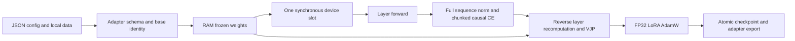

# Architecture and lifecycle

The library performs projection LoRA training with frozen bases. Its central boundary is the model-neutral `BlockPlan`, not an inference loader.

| Module | Responsibility |
|---|---|
| `config.py`, `cli.py` | Validate explicit local paths and supported options; dispatch named registry entries |
| `adapters/` | Validate architecture/shape/dtype, map weights and LoRA targets, generate positions/masks, terminal norm and artifact keys |
| `memory.py` | Pack frozen CPU tensors into aligned pinned arenas on CUDA, own one device slot and enforce serial lifecycle |
| `training/recompute.py` | Re-enter the same functional block during backward; produce input and projection gradients without retaining all base layers on device |
| `training/engine.py` | Normalize over supervised tokens across the accumulation window, orchestrate forward/backward/update and cancellation |
| `finetune/` | FP32 A/B masters, explicit gradient buffers and AdamW moments |
| `quantization/` | Declared internal group-128 storage, codec validation, bounded per-tensor conversion and compressed-base identity |
| `checkpoint_io/` | Validate complete state before restore; hash-bound atomic checkpoint/export publication |
| `data/` | Local tokenizer with remote code disabled, synthetic/token JSONL and strict assistant-span chat labeling |

Forward loads every declared decoder layer into the slot. Backward reloads layers in reverse and recomputes the same function; LoRA contributes at the actual projection input. The terminal norm runs on the full sequence; normalized-hidden gradients from chunked head/CE are assembled before one norm VJP. Norm/head and embeddings remain frozen, but their input derivatives participate in training.

`SlotSession` is serial and non-reentrant. A reload invalidates old slot views; functions cannot retain them across layers. Session closes before adapter. CUDA pinning replaces host tensors with arena views; closing the session invalidates that adapter plan. Initialize a fresh adapter for a new run. Default scheduling is synchronous; optional raw CUDA prefetch/cache follows explicit capability gates. There is no implicit CPU fallback.

Only frozen canonical embedding/head aliases are supported in declared Qwen variants. CPU may share one storage; CUDA keeps a RAM embedding and an explicit frozen head replica, budgeted by role. General shared trainable bases/LoRA aliases are rejected or outside the API.

A checkpoint holds A/B, gradient buffers and first/second moments for every projection, optimizer configuration/step, data cursor and Python/CPU/selected-device RNG. Binding includes the effective config, data contents/tokenization and base tensor identity. Resume validates all fields before mutation. Cancellation occurs at a complete update window and saves state; interruption during atomic export may leave complete artifacts while the run remains cancelled.

All frozen weights must currently fit RAM. Budgets constrain necessary capacities, not total process/activation peaks. Initialization, source hashing, pinned allocator rounding, the shared linear core, head, slot, logits/norm buffers, LoRA/optimizer and dependency imports all contribute. Measure RSS and swap separately from CUDA allocated/reserved, transfer payload and wall time. Lower VRAM use alone does not prove higher throughput.
